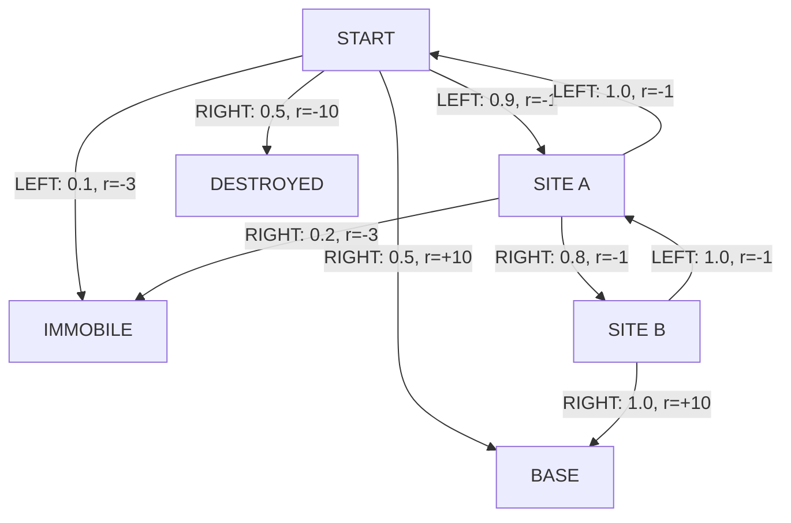

# Mars Rover MDP

A small reinforcement learning environment for a single agent exploring Mars, it learns a policy with Q-learning and visualizes the MDP and the learning process and shows the policy in action.

The project implements the Rover problem introduced in *Multi Agent Reinforcement Learning: Foundations and Modern Approaches* (MIT Press, 2024).

## Summary

- Configurable MDP from YAML.
- Q-learning with epsilon-greedy exploration.
- Fast training without UI and live visualization.
- Learned policy and report JSON persisted in `artifacts/`.
- Dashboard Dash/Cytoscape with MDP graph, trajectory, learned policy, Q-values and convergence.
- Automated tests for updating Q, exploration, training and live feed of the dashboard.

## Quick setup

From Powershell, in repository root:

```powershell
python -m venv .venv
.\.venv\Scripts\Activate.ps1
python -m pip install -r requirements.txt
python src\main.py --mode train
```

The training uses 20,000 episodes, saves the learned policy in `artifacts/learned_policy.yaml` and the report in `artifacts/training_report.json`. 

## Modes

| Mode              | Comand                                 |
|-------------------|----------------------------------------|
| Complete training | `python src\main.py --mode train`      |
| Evaluation        | `python src\main.py --mode evaluate`   |
| Policy demo       | `python src\main.py --mode demo`       |
| Visual training   | `python src\main.py --mode train-demo` |

The graphical modes start the server on [http://127.0.0.1:8050](http://127.0.0.1:8050). Open the address in your browser and press the start button in the dashboard.

For the visual training, use the slider to control the speed. `0s` completes the run quickly; a small delay makes the transitions readable.

## Problem statement

Rover starts from `START` and moves in a circle around the planet. States such as `BASE`, `IMMOBILE` and `DESTROYED` are terminal.



With `gamma = 0.95`, the greedy optimal policy is:

| State    | Greedy action |
|----------|---------------|
| `START`  | `LEFT`        |
| `SITE_A` | `RIGHT`       |
| `SITE_B` | `RIGHT`       |

This policy is deterministic, but the environment is not: the probability of reaching `BASE` is `0.9 x 0.8 x 1.0 = 72%`. The expected reward episode-wise is `+4.74`.

## How does the agent learn?

For every transaction `(s, a, r, s')`, the Q-value is updated:

```text
Q(s, a) <- Q(s, a) + alpha * [r + gamma * max_a' Q(s', a') - Q(s, a)]
```

In terminal states, the Q-value is not updated. During training, the action is chosen with epsilon-greedy:

```text
P(better action) = 1 - epsilon / 2
P(other action) = epsilon / 2
```
The training dashboard shows this **behavior policy** in real time, not just the greedy policy. It's normal that the greedy action changes quickly in training: just two Q-values need to flip. The convergence is read together with Q-values, average reward and arrival rate to `BASE`.

## Training dashboard

`train-demo` runs 5,000 episodes and updates in real time: 

- the graph and the transition that just happened;
- the current behavior epsilon-greedy policy;
- Q-values for all pairs of state-action;
- the current epsilon and reward of the current episode;
- the average reward and base rate for the interval;
- the convergence curve.

## Artifacts

| File | Content                                                                               |
| --- |---------------------------------------------------------------------------------------|
| `artifacts/learned_policy.yaml` | Final greedy policy. |
| `artifacts/training_report.json` | Iperparametri, metriche per intervallo, valutazione finale e Q-values.                |
| `logs/<run-id>.json` | Log delle esecuzioni visuali della policy.                                            |

`artifacts/` e ignorata da Git per non versionare output generati.

## Repository structure

```text
config/
  mdp.yaml                 Parameters
  initial_policy.yaml       Initial policy
src/
  main.py                   CLI
  model/                    Environment and episode loop
  rl/                       Q-learning and live observation
  renderer/                 Dashboard Dash/Cytoscape
  visualization/            Visualization state
```